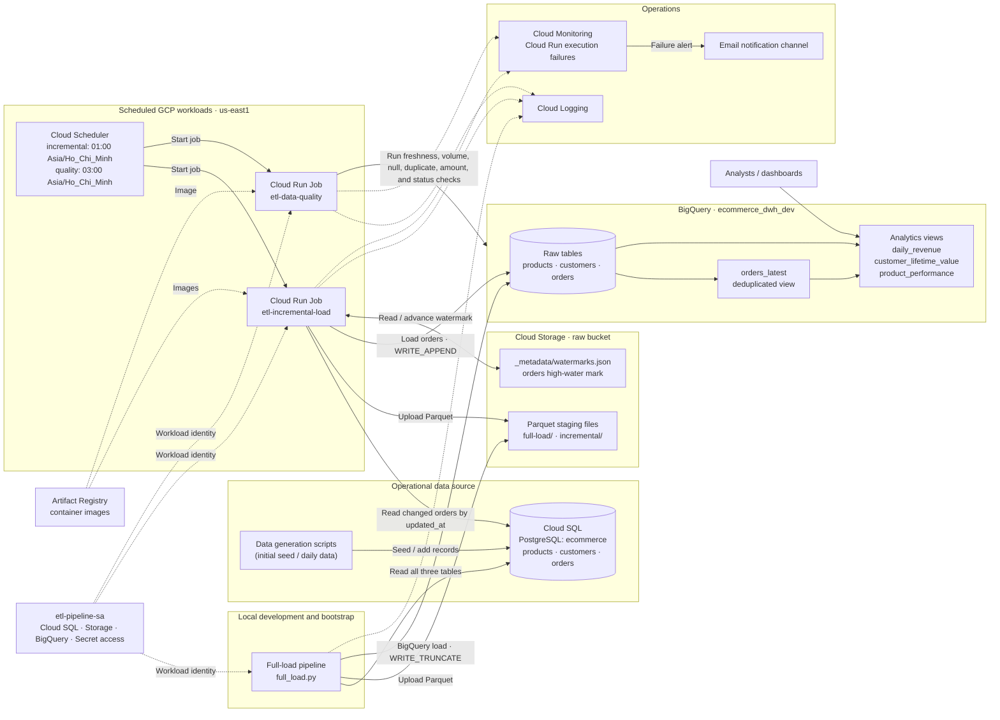

# ETL Pipeline on Google Cloud

## Project Overview

This project builds an ecommerce ETL pipeline that moves data from Cloud SQL (PostgreSQL on GCP) into BigQuery. It supports an initial full load of products, customers, and orders, followed by incremental loads of new or changed orders. Parquet files are staged in Cloud Storage before loading, and BigQuery views provide deduplicated orders and business analytics.

The repository also includes synthetic data generators, destination data quality checks, scheduled Cloud Run Jobs, and Cloud Monitoring failure alerts.

## Architecture



- **Full load:** `full-load/full_load.py` extracts all three source tables, stages Parquet files in GCS, then replaces the BigQuery tables.
- **Incremental load:** `incremental-load/incremental_load.py` extracts orders newer than a GCS-stored `updated_at` watermark and appends them to BigQuery. The `orders_latest` view selects the newest version of each order.
- **Automation:** Cloud Scheduler starts Cloud Run Jobs in `us-east1`. Incremental loading is scheduled daily at 01:00 and data quality checks at 03:00 `Asia/Ho_Chi_Minh` time.
- **Operations:** Job logs go to Cloud Logging. Cloud Monitoring can alert an email notification channel when a job fails.

See [docs/Architecture.md](docs/Architecture.md) for the architecture details and [docs/Implementation.md](docs/Implementation.md) for the full GCP setup walkthrough.

## Tech Stacks

- Programming Language: **Python**
- Google Cloud Platform services:

   - **Cloud SQL**: Fully managed database for PostgreSQL
   - **Cloud Storage**: Object storage that's secure, durable, and scaleable
   - **BigQuery**: Data warehouse for business agility and insights
   - **Cloud IAM**: Permissions management system for Google Cloud resources
   - **Artifact Registry**: Store, manage, and secure container images and language packages
   - **Cloud Run**: Fully managed environment for running containerized apps
   - **Cloud Scheduler**: Cron job scheduler for task automation and management
   - **Cloud Monitoring**: Infrastructure and application health rich metrics
   - **Cloud Logging**: Google Cloud audit, platform, and application logs managements
   - **Secret Manager** (optional, in production): Store API keys, passwords, certificates, and other sensitive data

- Containerization: **Docker**

## Prerequisites

- A Google Cloud project with billing enabled
- `gcloud`, `bq`, Docker, Python, and `uv` installed locally
- Enabled GCP APIs for Cloud SQL, Cloud Storage, BigQuery, Cloud Run, Cloud Scheduler, Artifact Registry, and Secret Manager (Secret Manager is used for production secret handling)
- A Cloud SQL PostgreSQL instance with an `ecommerce` database and an `etl_user` account
- An `etl-pipeline-sa` service account with the required Cloud SQL, Storage, BigQuery, Cloud Run, and Secret Manager permissions
- A service account key for local development, stored outside source control
- A raw GCS bucket and BigQuery dataset (the implementation guide uses `etl-pipeline-gcp-raw-dev` and `ecommerce_dwh_dev`)

Configure a `.env` file with `GCP_PROJECT_ID`, `GOOGLE_APPLICATION_CREDENTIALS`, `POSTGRES_HOST`, `POSTGRES_PORT`, `POSTGRES_DB`, `POSTGRES_USER`, `POSTGRES_PASSWORD`, and the bucket configuration expected by the scripts. The local PostgreSQL host is the Cloud SQL public IP; Cloud Run uses the Cloud SQL Unix socket path. Never commit credentials or `.env` secrets.

For the exact API, IAM, database, bucket, and dataset setup steps, follow [docs/Implementation.md](docs/Implementation.md).

## How to Run the Project

From the repository root, create and activate a virtual environment, then install the dependencies declared in `pyproject.toml`:

```bash
uv venv
source .venv/bin/activate
uv sync
```

1. **Seed the source database** (one-time):

   ```bash
   chmod +x data-generation/seed_database.sh
   ./data-generation/seed_database.sh
   ```

2. **Run the initial full load** after creating the GCS bucket and BigQuery dataset:

   ```bash
   python full-load/full_load.py
   ```

3. **Create daily source data** when you want to simulate new registrations and orders:

   ```bash
   python data-generation/generate_daily.py
   ```

4. **Run an incremental load** to append changed/new orders:

   ```bash
   python incremental-load/incremental_load.py
   ```

5. **Run destination data quality checks:**

   ```bash
   python data-quality/quality_checks.py
   ```

6. **Create or update the analytics views** by running the SQL files in `analytics/views/` in the `ecommerce_dwh_dev` BigQuery dataset. The incremental pipeline also relies on the `orders_latest` view; its SQL is documented in [docs/Implementation.md](docs/Implementation.md).

To deploy scheduled jobs and alerts, follow the Cloud Run, Scheduler, and Monitoring steps in [docs/Implementation.md](docs/Implementation.md). The guide uses project-specific example resource names; adjust them to your GCP project and configuration.

## Output: Three Views in BigQuery

The analytics SQL files in `analytics/views/` create three reporting views in the `ecommerce_dwh_dev` dataset:

| View | Description |
|---|---|
| `daily_revenue` | Daily order, revenue, discount, tax, shipping, completion, and cancellation metrics. |
| `customer_lifetime_value` | Customer-level lifetime value, order frequency, recency, value tier, and activity status. |
| `product_performance` | Product-level revenue, cost of goods sold, profit, margin, and performance tier. |

The separate `orders_latest` view deduplicates appended order versions by keeping the row with the latest `updated_at` per `order_id`; the analytics views use it for current order data.

## Limitations

- Incremental loading currently covers **orders only**. Changes to products or customers are not synchronized by the incremental job.
- The full load reads each entire source table into a pandas DataFrame in memory, so it may not scale well as source data grows.
- Incremental correctness depends on a reliable `updated_at` column and the GCS watermark. The pipeline appends versions, so consumers should query `orders_latest` instead of raw `orders` when they need one current row per order.
- The example setup uses a public Cloud SQL IP for local development and project-specific names and values. Production deployments should use appropriately secured networking and Secret Manager for credentials.
- Data quality thresholds and allowed order statuses are fixed in the checks and may need adjustment for a different workload. Warning-level failures can occur while critical checks still pass.
- Analytics views calculate results when queried; they are not materialized tables and query cost depends on the data scanned.
