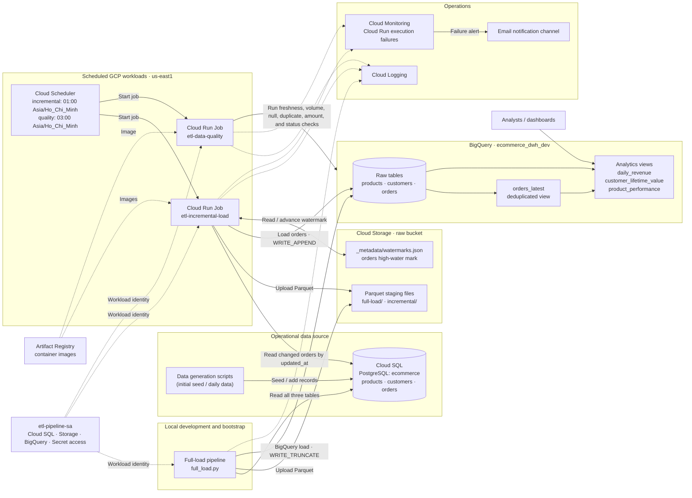

# Architecture

## Architecture Overview

Cloud SQL PostgreSQL is the operational source for the ecommerce `products`, `customers`, and `orders` data. Data generation scripts seed the initial dataset and can add daily customers and orders. The pipeline stages extracts as Parquet in a Cloud Storage raw bucket before loading them into the `ecommerce_dwh_dev` BigQuery dataset.

### Data Flows

- **Initial full load:** Run `full-load/full_load.py` locally to extract the three source tables, stage Parquet files in GCS, and load BigQuery tables with `WRITE_TRUNCATE`.
- **Incremental load:** Cloud Scheduler starts the `etl-incremental-load` Cloud Run Job daily at 01:00 Asia/Ho_Chi_Minh. The job reads orders newer than the stored `updated_at` watermark, stages them in GCS, appends them to the BigQuery `orders` table, and advances the watermark in `/_metadata/watermarks.json`.
- **Data quality:** Cloud Scheduler starts `etl-data-quality` daily at 03:00 Asia/Ho_Chi_Minh. It checks destination freshness, volume, nulls, duplicates, amount validity, and order status validity. Critical failures cause the job to fail.
- **Analytics:** The `orders_latest` view selects the latest version of each order. The `daily_revenue`, `customer_lifetime_value`, and `product_performance` views provide the reporting layer for analysts and dashboards.

### Runtime and Access

The incremental load and data quality jobs run as Cloud Run Jobs using images stored in Artifact Registry. The `etl-pipeline-sa` service account grants workloads access to Cloud SQL, Cloud Storage, BigQuery, and Secret Manager for the database password. Local scripts use the configured service account credentials during development.

### Observability

Cloud Run job output is available in Cloud Logging. Cloud Monitoring watches job execution failures and sends notifications through the configured email channel. Data quality check results are reported by the quality job; a critical check failure surfaces as a failed Cloud Run execution and can trigger the failure alert.
