# Implementation

## Step 1: Setting Up GCP

### Create a GCP Project

Go to [console.cloud.google.com](https://console.cloud.google.com/) and create a new project with the given project name (e.g., `etl-pipeline-gcp`).

### Enable the required APIs

GCP services are disabled by default and must be explicitly enabled.
Go to **APIs & Services** -> **Enable APIs and services** and enable **Cloud SQL Admin API**

### Create a Service Account

Scripts need to authenticate with GCP. So creating a **service account**, which is a dedicated identity for application.
Go to **IAM & Admin -> Service Accounts -> Create Service Account**:
- Name: `etl-pipeline-sa`
- Description: `Service account for ETL pipeline operations`

Assign role:
- **Cloud SQL Client** — connect to Cloud SQL instances

Then create and download a **JSON key** for this service account. Save it somewhere safe on local machine — **never commit this file to Git**.

### Create a Cloud SQL PostgreSQL Instance

This is data source, the operational database that simulates a live e-commerce application’s backend.
Go to **SQL -> Create Instance -> Choose PostgreSQL**
Under **Connections**:
- Add local machine’s IP to **Authorized Networks**

### Create the Database and User

Click into instance -> **Databases -> Create Database**:
- Name: `ecommerce`

Then **Users -> Add User Account**:
- Username: `etl_user`
- Password: (set a password)

## Step 2: Local Project Setup

### Create the Project Folder and Virtual Environment

Open terminal and create the project:
  
```bash
mkdir etl-pipeline-gcp
cd etl-pipeline-gcp
```

Now create a Python virtual environment.

```bash
uv init
uv venv
```

### Set Up Environment Variables

Create a `.env` file to store GCP credentials and project configs.

```bash
# Environment
ETL_ENVIRONMENT=development

# Google Cloud Platform
GCP_PROJECT_ID=
GOOGLE_APPLICATION_CREDENTIALS=/path/to/your/service-account-key.json

# PostgreSQL (Cloud SQL)
POSTGRES_HOST=     # Cloud SQL public IP
POSTGRES_PORT=5432
POSTGRES_DB=ecommerce
POSTGRES_USER=etl_user
POSTGRES_PASSWORD=your_password

# Local Development
LOCAL_DEVELOPMENT=true
DEBUG=true
```

## Step 3: Seeding the Database — Generating Synthetic Data

Populate realistic data into PostgreSQL instance. This is a one-time setup step. All code lives under `data-generation/`. It creates:
- **products** (5,000 rows) — catalog with categories, brands, prices
- **customers** (20,000 rows) — European customers across 6 countries
- **orders** (500,000 rows) — one year of transaction history (Feb 2025 — Feb 2026)

Install dependencies:

```bash
uv add -r requirements.txt
```

Run `seed_database.sh` bash script:

```bash
chmod +x data-generation/seed_database.sh
./data-generation/seed_database.sh
```

After the terminal prints `Seeding complete!`, go to **Cloud SQL -> etl-pipeline-gcp-postgres -> Cloud SQL Studio** and run:

```sql
SELECT
  (SELECT COUNT(*) FROM products)  AS products,
  (SELECT COUNT(*) FROM customers) AS customers,
  (SELECT COUNT(*) FROM orders)    AS orders;
```

Expected:

```
products: 5000
customers: 20000
orders: 500000
```

## Step 4: Moving Data — The Full Load Pipeline

Next, building a full load pipeline that extracts everything from PostgreSQL and lands it in BigQuery.

### What is a Full Load?

A full load is the simplest ETL pattern: **extract everything, replace everything**.

Every time it runs, it reads all rows from the source, stages them in Cloud Storage, and overwrites the destination tables in BigQuery from scratch.

No merging, no change detection, just a clean replacement.

### The ETL Pattern — With a Staging Area

In a naive implementation, all three steps happen inside a single script: extract from PostgreSQL, reshape in memory, and write directly into BigQuery. This works for small datasets but has a serious problem: the steps are tightly coupled. If the load fails, you re-run everything.

The solution is a **staging area**. A temporary storage space that sits between extraction and transformation:

```bash
PostgreSQL -> [Extract] -> GCS (Staging Area) -> [Transform] -> [Load] -> BigQuery
```

Extracted data lands in GCS exactly as it came out of the source. Transformations read from GCS, not from PostgreSQL. The load writes final shaped data to BigQuery. Each step is isolated and independently retriable.

### Enable the APIs

Two more GCP APIs are needed. Go to **APIs & Services -> Enable APIs and Services** and enable:
- **Cloud Storage API**
- **BigQuery API**

### Add IAM Roles to the Service Account

Service account (`etl-pipeline-sa`) currently only has **Cloud SQL Client**. Now it needs to write to Cloud Storage and read/write BigQuery.

Go to **IAM & Admin -> IAM**, find `etl-pipeline-sa@etl-pipeline-gcp.iam.gserviceaccount.com`, and add:
- **Storage Admin** — create buckets and upload files
- **BigQuery Data Editor** — create tables and load data
- **BigQuery Job User** — run load jobs

### Create the GCS Buckets

Authenticate with `gcloud`:

```bash
gcloud auth login
```

Run the script:

```bash
chmod +x scripts/create_buckets.sh
./scripts/create_buckets.sh
```

The script reads the names and region from .env, checks if each bucket already exists (safe to re-run), and creates any that are missing. Ensure see `✅ Created: gs://etl-pipeline-gcp-raw-dev` in output.

### Create the BigQuery Dataset

Run:

```bash
bq mk --location=us --dataset etl-pipeline-gcp:ecommerce_dwh_dev
# Dataset 'etl-pipeline-gcp:ecommerce_dwh_dev' successfully created
```

### The Pipeline

All code is in `full-load/full_load.py`. It does:
- **Extract**: Connects to Cloud SQL and runs `SELECT * FROM {table}` for each of the three tables. The result comes back as a pandas DataFrame in memory.
- **Stage**: Serializes each DataFrame to a **Parquet file** in a temp directory and uploads it to the raw GCS bucket.
- **Load**: Triggers a BigQuery load job pointing at the GCS URI.

Run the script:

```bash
python full-load/full_load.py
```

Expected output:

```bash
# Full load complete!
# BigQuery: etl-pipeline-gcp.ecommerce_dwh_dev
```

Go to **BigQuery -> etl-pipeline-gcp -> ecommerce_dwh_dev** and run:

```sql
SELECT
  (SELECT COUNT(*) FROM ecommerce_dwh_dev.products)  AS products,
  (SELECT COUNT(*) FROM ecommerce_dwh_dev.customers) AS customers,
  (SELECT COUNT(*) FROM ecommerce_dwh_dev.orders)    AS orders;
```

Expected:

```
products: 5000
customers: 20000
orders: 500000
```

Also, verify the raw files landed in GCS:

```bash
gcloud storage ls --recursive gs://etl-pipeline-gcp-raw-dev/**
# Should see three Parquet files
```

## Step 5: Keeping It Fresh — The Incremental Load Pipeline

Running the full load pipeline every day would work technically, but it’s wasteful — re-extract, re-upload, and re-load half a million rows just to capture a hundred new ones. As data grows, this becomes impractical.

The solution is an **incremental load**: only move what changed.

### The High-Water Mark Pattern

The most common approach to incremental loading is the high-water mark, a timestamp that marks the last point in time that successfully loaded.

```
Last run watermark:  2026-02-27T00:00:00
New orders to sync:  WHERE updated_at > '2026-02-27T00:00:00'
New watermark after: MAX(updated_at) from this batch
```

Every incremental run:
1. Reads the stored watermark
2. Queries PostgreSQL for rows newer than that watermark
3. Uploads them to GCS
4. Appends them to BigQuery
5. Updates the watermark to the newest `updated_at` seen

This works because our `orders` table has an `updated_at` column that’s set at insert time and updated whenever an order’s status changes.

Store the watermark in GCS at `gs://{RAW_BUCKET}/_metadata/watermarks.json`.

```json
{
    "orders": "2026-02-27T23:59:59.123456"
}
```

Using GCS means the watermark survives when container restarts and Cloud Run jobs.

### What Happens to Duplicate Orders in BigQuery?

Using `WRITE_APPEND` for incremental loads, not `WRITE_TRUNCATE`. This means each run adds row, it doesn’t replace them.

If an order’s status changes (e.g. `pending` -> `shipped`), the next incremental run will append the updated row. There are two rows for the same `order_id` — the original and the update.

For this pipeline, handling duplicates downstream with a BigQuery view that keeps only the latest version per `order_id`:

```sql
CREATE OR REPLACE VIEW ecommerce_dwh_dev.orders_latest AS
SELECT * EXCEPT(row_num)
FROM (
SELECT *,
    ROW_NUMBER() OVER (PARTITION BY order_id ORDER BY updated_at DESC) AS row_num
FROM ecommerce_dwh_dev.orders
)
WHERE row_num = 1;
```

Analysts query `orders_latest` rather than `orders` directly. Simple and cost-effective, BigQuery is fast at this kind of deduplication.

### Simulate New Daily Data

The incremental pipeline only moves rows that are genuinely new. Before running it, insert data into PostgreSQL that didn’t exist during the full load.

`data-generation/generate_daily.py` handles this. It connects directly to PostgreSQL and inserts:
- 20 new customer registrations
- 100 new orders

Run the script:

```bash
python data-generation/generate_daily.py
```

Expected output:

```bash
============================================================
Daily Data Generator
Date : 2026-11-03
============================================================
✅ Inserted 20 new customers
✅ Inserted 100 new orders

Done! Run incremental-load/incremental_load.py to move this data to BigQuery.
```

### Run the Incremental Pipeline

**First run** (no watermark yet — extracts everything as baseline):

```bash
python incremental-load/incremental_load.py
```

Expected output:

```bash
============================================================
Incremental Load Pipeline: PostgreSQL -> GCS -> BigQuery
Run     : 20261103T052605Z
Project : etl-pipeline-gcp
Bucket  : etl-pipeline-gcp-raw-dev
Dataset : ecommerce_dwh_dev
============================================================

[ORDERS]
⚠️  No watermark found. Extracting all orders as baseline.
Watermark : none (full extract)
Extracted : 500,100 rows in 352.4s
Uploading to gs://etl-pipeline-gcp-raw-dev/incremental/20261103T052605Z/orders.parquet...
    ✅ Uploaded
Loading into BigQuery ecommerce_dwh_dev.orders (APPEND)...
✅ Done in 5.0s — 1,000,100 total rows in BigQuery

Watermark updated -> 2026-11-03T12:33:34.466464

============================================================
Incremental load complete!
============================================================
```

After the first run, the watermark is written to GCS (`gs://{RAW_BUCKET}/_metadata/watermarks.json`):

```json
{
    "orders": "2026-11-03T12:33:34.466464"
}
```

Generate new daily data:

```bash
python data-generation/generate_daily.py
```

```bash
============================================================
Daily Data Generator
Date : 2026-11-03
============================================================
✅ Inserted 20 new customers
✅ Inserted 100 new orders

Done! Run incremental-load/incremental_load.py to move this data to BigQuery.
```

Load again:

```bash
python incremental-load/incremental_load.py
```

You see pipeline extracts only the updated records:

```bash
============================================================
Incremental Load Pipeline: PostgreSQL -> GCS -> BigQuery
Run     : 20261103T053950Z
Project : etl-pipeline-gcp
Bucket  : etl-pipeline-gcp-raw-dev
Dataset : ecommerce_dwh_dev
============================================================

[ORDERS]
Watermark : 2026-11-03 12:33:34.466464
Extracted : 100 rows in 10.9s
Uploading to gs://etl-pipeline-gcp-raw-dev/incremental/20261103T053950Z/orders.parquet...
    ✅ Uploaded
Loading into BigQuery ecommerce_dwh_dev.orders (APPEND)...
✅ Done in 3.1s — 1,000,200 total rows in BigQuery

Watermark updated -> 2026-11-03T12:39:38.263644

============================================================
Incremental load complete!
============================================================
```

### Create the Deduplication View

In BigQuery, create a view:

```sql
CREATE OR REPLACE VIEW `ecommerce_dwh_dev.orders_latest` AS
SELECT * EXCEPT(row_num)
FROM (
SELECT *,
    ROW_NUMBER() OVER (
    PARTITION BY order_id
    ORDER BY updated_at DESC
    ) AS row_num
FROM `ecommerce_dwh_dev.orders`
)
WHERE row_num = 1;
```

Now `orders_latest` always returns exactly one row per `order_id` — the most recent version. Analysts and dashboards use this view, not the raw `orders` table.

```sql
SELECT * FROM `etl-pipeline-gcp.ecommerce_dwh_dev.orders_latest` LIMIT 1000
```

Expected output:

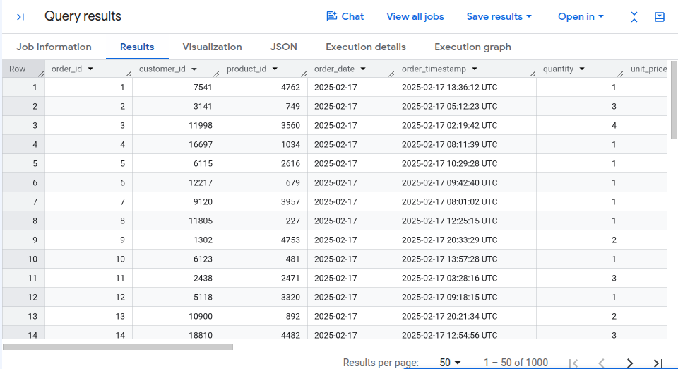

Run this:

```sql
SELECT
    (SELECT COUNT(*) FROM ecommerce_dwh_dev.orders)        AS orders_raw,
    (SELECT COUNT(*) FROM ecommerce_dwh_dev.orders_latest) AS orders_deduplicated;
```

The `orders_latest` count should be ≤ `orders_raw`. If they're equal, no duplicates have appeared yet (no order status updates).

```
orders_raw: 1000200
orders_deduplicated: 500200
```

## Step 6: Automating the Pipeline with Cloud Run Jobs and Cloud Scheduler

Until now, two pipelines have been built:
- A **full load** pipeline that snapshots all three PostgreSQL tables into BigQuery
- An **incremental load** pipeline that picks up only new and changed orders since the last run

This step wires up the automation.

```bash
Cloud Scheduler          Cloud Run Job           GCP Services
(cron: 0 1 * * *)  ──►  incremental_load.py    ──►  Cloud SQL (read)
                                               ──►  GCS (write parquet + watermark)
                                               ──►  BigQuery (append orders)
```

### Why Cloud Run Jobs?

There are several ways to run scheduled Python on GCP:

| Option | Fits this pipeline? | Notes |
|-|-|-|
| Cloud Run Jobs | Yes | Batch semantics, no timeout concerns, pays per use |
| Cloud Functions | Maybe | Gen2 max timeout is 9 min - fine for small batches, risky at scale |
| Compute Engine | Overkill | Always-on VM, not worth it for a 30s daily job |
| Dataflow | Overkill | Beam pipelines for large distributed transforms - not a Python script |
| Cloud Composer | Overkill | Managed Airflow, great for complex DAGs, expensive for one job |

Cloud Run Jobs are the right fit: they run a container to completion — exactly what a batch ETL script is.

### Enable APIs and Create a Service Account

Run the script:

```bash
bash scripts/setup_cloud_run_prereqs.sh
```

The script:

1. Reads `GCP_PROJECT_ID` from your `.env`
2. Enables the three required APIs (`run`, `cloudscheduler`, `artifactregistry`)
3. Creates the `etl-pipeline-sa` service account (skips if it already exists)
4. Binds exactly the roles the pipeline needs:

    | Role | Why |
    |-|-|
    | `roles/cloudsql.client` | Read from Cloud SQL |
    | `roles/storage.objectAdmin` | Read/write GCS (parquet files + watermark) |
    | `roles/bigquery.dataEditor` | Append rows to BigQuery tables |
    | `roles/bigquery.jobUser` | Submit BigQuery load jobs |
    | `roles/run.invoker` | Allow Cloud Scheduler to trigger the Cloud Run Job |

### One code change needed

Locally, we connect to Cloud SQL via its public IP over TCP (`host:port`). Inside Cloud Run, the managed Cloud SQL Auth Proxy uses a **Unix socket** instead:

```bash
/cloudsql/PROJECT_ID:REGION:INSTANCE_NAME
```

Local development: `POSTGRES_HOST=34.x.x.x` -> TCP connection as before.

Cloud Run: `POSTGRES_HOST=/cloudsql/etl-pipeline-gcp:us-east1:etl-pipeline-gcp-postgres` -> Unix socket.

`incremental_load.py` already handles both — right after the base `DB_URL` it checks whether `POSTGRES_HOST` starts with `/` and rewrites the URL accordingly

### Push the Image to Artifact Registry

Create a Docker repository:

```bash
gcloud artifacts repositories create etl-pipeline \
    --repository-format=docker \
    --location=us-east1 \
    --description="ETL pipeline container images" \
    --project=etl-pipeline-gcp
```

Authenticate Docker:

```bash
gcloud auth configure-docker us-east1-docker.pkg.dev
```

Build and push:

```bash
IMAGE="us-east1-docker.pkg.dev/etl-pipeline-gcp/etl-pipeline/incremental-load:latest" && docker build -t $IMAGE ./incremental-load/ && docker push $IMAGE
```

Create the Cloud Run Job:

```bash
INSTANCE_CONNECTION_NAME="${PROJECT_ID}:us-east1:etl-pipeline-gcp-postgres"

gcloud run jobs create etl-incremental-load \
    --image=$IMAGE \
    --region=us-east1 \
    --service-account=$SA_EMAIL \
    --set-cloudsql-instances=$INSTANCE_CONNECTION_NAME \
    --set-env-vars="GCP_PROJECT_ID=${PROJECT_ID}" \
    --set-env-vars="GCS_RAW_BUCKET=etl-pipeline-gcp-raw-dev" \
    --set-env-vars="POSTGRES_HOST=/cloudsql/${INSTANCE_CONNECTION_NAME}" \
    --set-env-vars="POSTGRES_DB=ecommerce" \
    --set-env-vars="POSTGRES_USER=etl_user" \
    --set-env-vars="POSTGRES_PASSWORD=your-password-here" \
    --max-retries=2 \
    --task-timeout=3600 \
    --project=$PROJECT_ID
```

**Production note**: `POSTGRES_PASSWORD` in `--set-env-vars` is stored in plain text in Cloud Run. For real production, store the password in Secret Manager and reference it with `--set-secrets="POSTGRES_PASSWORD=postgres-password:latest"`.

### Test the Job

Run:

```bash
# You should run "python data-generation/generate_daily" first to insert the new data
gcloud run jobs execute etl-incremental-load \
    --region=us-east1 \
    --project=etl-pipeline-gcp \
    --wait
```

Expected output:

```bash
✓ Creating execution... Done.                                                                                    
    ✓ Provisioning resources... Provisioned imported containers.                                                   
    ✓ Starting execution... Started deployed execution in 18.63s.                                                  
    ✓ Running execution... 1 / 1 complete                                                                          
Done.                                                                                                            
Execution [etl-incremental-load-t82wb] has successfully completed.
```

### Create the Cloud Scheduler Job

Now we wire up the trigger. Every night at 01:00 Asia/Ho_Chi_Minh, Cloud Scheduler sends an authenticated HTTP POST to the Cloud Run Jobs API to start an execution.

Run:

```bash
gcloud scheduler jobs create http etl-incremental-load-daily \
    --location=us-east1 \
    --schedule="0 1 * * *" \
    --time-zone="Asia/Ho_Chi_Minh" \
    --uri="https://us-east1-run.googleapis.com/apis/run.googleapis.com/v1/namespaces/etl-pipeline-gcp/jobs/etl-incremental-load:run" \
    --http-method=POST \
    --oauth-service-account-email=etl-pipeline-sa@etl-pipeline-gcp.iam.gserviceaccount.com \
    --project=etl-pipeline-gcp
```

Breaking down the cron schedule `0 1 * * *`:

```bash
    0    1    *    *    *
│    │    │    │    └── day of week (any)
│    │    │    └─────── month (any)
│    │    └──────────── day of month (any)
│    └───────────────── hour (01:00)
└────────────────────── minute (00)
```

1 AM Ho Chi Minh time. The pipeline runs after midnight when database load is lowest, and BigQuery has fresh data before the business day starts.

Test the scheduler manually (without waiting for 1 AM):

```bash
# You should run "python data-generation/generate_daily" first to insert the new data
gcloud scheduler jobs run etl-incremental-load-daily \
    --location=us-east1 \
    --project=etl-pipeline-gcp

gcloud run jobs executions list \
    --job=etl-incremental-load \
    --region=us-east1 \
    --project=etl-pipeline-gcp \
    --limit=5 \
    --format="table(name, status.completionTime, status.succeededCount, status.failedCount)"
```

Output:

```bash
EXECUTION                   COMPLETION_TIME              SUCCEEDED_COUNT  FAILED_COUNT
etl-incremental-load-sbcrr  2026-11-04T15:38:50.774861Z  1
etl-incremental-load-qkdtz  2026-11-04T15:23:08.333478Z  1
etl-incremental-load-t82wb  2026-11-04T15:20:11.860943Z  1
```

After a successful scheduled run, confirm the data landed:

```sql
SELECT
    DATE(order_date)    AS day,
    COUNT(*)            AS total_rows,
    MAX(updated_at)     AS latest_updated_at
FROM `ecommerce_dwh_dev.orders`
GROUP BY 1
ORDER BY 1 DESC
LIMIT 5;
```

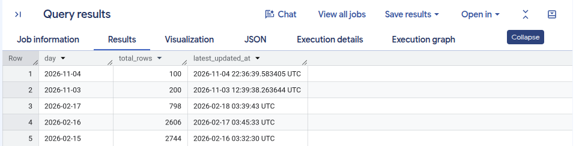

Now confirm the deduplication view from Step 3:

```sql
SELECT
    (SELECT COUNT(*) FROM `ecommerce_dwh_dev.orders`)         AS orders_raw,
    (SELECT COUNT(*) FROM `ecommerce_dwh_dev.orders_latest`)  AS orders_deduplicated;
```

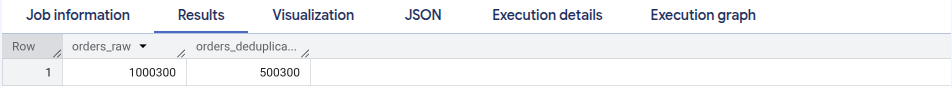

### Upgrading to Secret Manager

The current setup stores `POSTGRES_PASSWORD` as a plain env var in Cloud Run. That's fine for experimentation, but in production secrets must be managed more properly. Create a secret and load it into Cloud Run.

Enable the API (if not already enabled):

```bash
gcloud services enable secretmanager.googleapis.com --project=$PROJECT_ID
```

Create the secret:

```bash
echo -n "your-password" | gcloud secrets create postgres-password \
    --data-file=- \
    --project=$PROJECT_ID
# Created version [1] of the secret [postgres-password].
```

Grant the service account access:

```bash
gcloud secrets add-iam-policy-binding postgres-password \
    --member="serviceAccount:${SA_EMAIL}" \
    --role="roles/secretmanager.secretAccessor" \
    --project=$PROJECT_ID
```

Output:

```bash
Updated IAM policy for secret [postgres-password].
...
```

Update the Cloud Run Job to use the secret instead of plain env var:

```bash
gcloud run jobs update etl-incremental-load \
    --region=us-east1 \
    --remove-env-vars="POSTGRES_PASSWORD" \
    --set-secrets="POSTGRES_PASSWORD=postgres-password:latest" \
    --project=$PROJECT_ID
```

Output:

```bash
Updating Cloud Run job [etl-incremental-load] in project [etl-pipeline-gcp] region [us-east1]
...              
Job [etl-incremental-load] has successfully been updated.
```

## Step 7: Data Quality Checks

### Why Checks at the Destination, Not the Source

A natural instinct is to validate data when it comes in. Check the CSV, validate the Parquet file before loading.

That’s useful, but insufficient. The real question is whether BigQuery reflects reality.

Checking at the destination catches a wider class of problems:
- The load job silently dropped rows (this happens with schema mismatches)
- The watermark advanced too far and skipped a day’s worth of data
- A bug in `generate_daily.py` produced structurally valid but semantically wrong rows.
- The deduplication view is broken after a schema change

### The Six Checks

`data-quality/quality_checks.py` runs these checks against BigQuery:

| Check | Severity | What it catches |
|-|-|-|
| Freshness | CRITICAL | No rows arrived in the last 24h - pipline may have silently failed |
| Volume | WARNING | Batch outside expected range (10-10,000 rows) - unusual drop or spike |
| Nulls | CRITICAL | Nulls in `order_id`, `customer_id`, `product_id`, `order_date`, `total_amount` |
| Duplicates | CRITICAL | `orders_latest` view contains more than one row per `order_id` |
| Negatives | WARNING | `total_amount <= 0` - data generation bug or upstream corruption |
| Status validity | WARNING | `order_status` values outside the allowed set |

Run the checks:

```bash
python data-quality/quality_checks.py
```

Expected output:

```bash
============================================================
Data Quality Checks
Run     : 2026-11-04T04:30:54Z
Project : etl-pipeline-gcp
Dataset : ecommerce_dwh_dev
============================================================

  ✅  Freshness: rows in last 24h              PASS  —  200 rows with updated_at >= 2026-11-03 04:30:54
  ✅  Volume: batch within expected range      PASS  —  200 rows  (expected 10-10,000)
  ✅  Nulls: order_id                          PASS  —  0 null rows
  ✅  Nulls: customer_id                       PASS  —  0 null rows
  ✅  Nulls: product_id                        PASS  —  0 null rows
  ✅  Nulls: order_date                        PASS  —  0 null rows
  ✅  Nulls: total_amount                      PASS  —  0 null rows
  ✅  Duplicates: orders_latest unique order_id PASS  —  0 duplicate order_ids in view
  ✅  Negatives: total_amount > 0              PASS  —  0 rows with total_amount <= 0
  ⚠️   Validity: order_status values            FAIL [WARNING]  —  unexpected values: ['delivered', 'paid', 'processing', 'refunded', 'returned']

============================================================
  9/10 checks passed  |  1 failed  |  0 critical
============================================================

✅  All critical checks passed.
```

Create a second Cloud Run Job (`etl-data-quality`) and schedule it 10 minutes after the incremental load.

This keeps the two concerns independent. If the quality check fails, the incremental load history is clean — you can investigate and re-run quality checks without re-running the load.

```bash
docker build --no-cache --platform linux/amd64 \
    -t us-east1-docker.pkg.dev/etl-pipeline-gcp/etl-pipeline/data-quality:latest \
    ./data-quality/

docker push us-east1-docker.pkg.dev/etl-pipeline-gcp/etl-pipeline/data-quality:latest
```

Image pushed. Now create the Cloud Run Job and Scheduler trigger:

```bash
gcloud run jobs create etl-data-quality \
    --image=us-east1-docker.pkg.dev/etl-pipeline-gcp/etl-pipeline/data-quality:latest \
    --region=us-east1 \
    --service-account=etl-pipeline-sa@etl-pipeline-gcp.iam.gserviceaccount.com \
    --set-env-vars="GCP_PROJECT_ID=etl-pipeline-gcp" \
    --max-retries=1 \
    --task-timeout=300 \
    --project=etl-pipeline-gcp
```

```bash
gcloud scheduler jobs create http etl-data-quality-daily \
    --location=us-east1 \
    --schedule="0 3 * * *" \
    --time-zone="Asia/Ho_Chi_Minh" \
    --uri="https://us-east1-run.googleapis.com/apis/run.googleapis.com/v1/namespaces/etl-pipeline-gcp/jobs/etl-data-quality:run" \
    --http-method=POST \
    --oauth-service-account-email=etl-pipeline-sa@etl-pipeline-gcp.iam.gserviceaccount.com \
    --project=etl-pipeline-gcp
```

A quick end-to-end test:

```bash
gcloud run jobs execute etl-data-quality \
    --region=us-east1 \
    --project=etl-pipeline-gcp \
    --wait
```

## Step 8: The Analytics Layer

This step adds analytics layer on top of BigQuery raw tables: three views that answer the questions a business actually asks.

### Views, Not Tables

There are some options for the analytics layer:

| Approach | How it works | Tradeoff |
|-|-|-|
| Raw queries | Analysts write SQL against `orders_latest` directly | Duplicated logic, fragile |
| Views | Named SQL queries stored in BigQuery | Zero storage cost, always current, logic in one place |
| Materialized views | BigQuery pre-computes and caches the result | costs money, auto-refresh restrictions |
| Scheduled query -> table | Python/SQL job writes results to a new table | Extra orchestration, staleness risk |

### The Three Views

All three views lie in `analytics/views/*.sql`

1. **Daily Revenue**: Daily aggregation of every order metric: volume, revenue, discounts, tax, shipping, completion rate, cancellation rate. This is the view a dashboard queries for a trend chart.

    ```sql
    SELECT * FROM `ecommerce_dwh_dev.daily_revenue`
    WHERE order_date >= DATE_SUB(CURRENT_DATE(), INTERVAL 30 DAY)
    ORDER BY order_date DESC;
    ```

    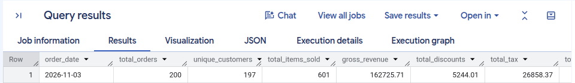
    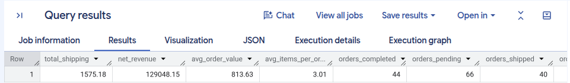
    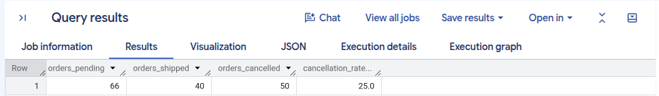


2. **Customer Lifetime Value**: One row per customer. Joins `customers` (registration data) with `orders_latest` (purchase history) to compute lifetime value, order frequency, recency, a value tier, and an activity status.

    ```sql
    SELECT * FROM `ecommerce_dwh_dev.customer_lifetime_value`
    WHERE customer_status = 'Active'
    ORDER BY lifetime_value DESC
    LIMIT 100;
    ```

    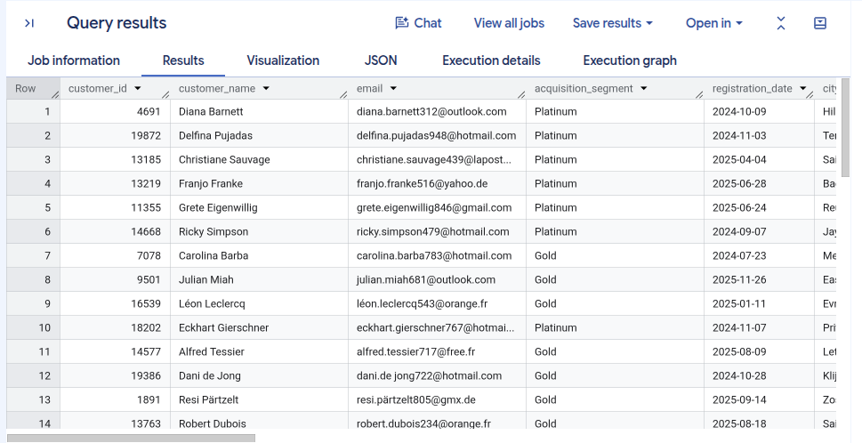
    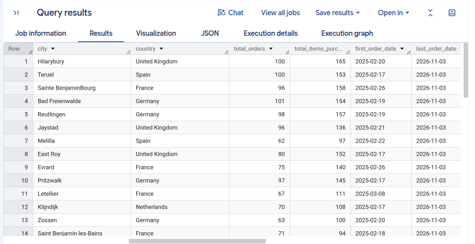
    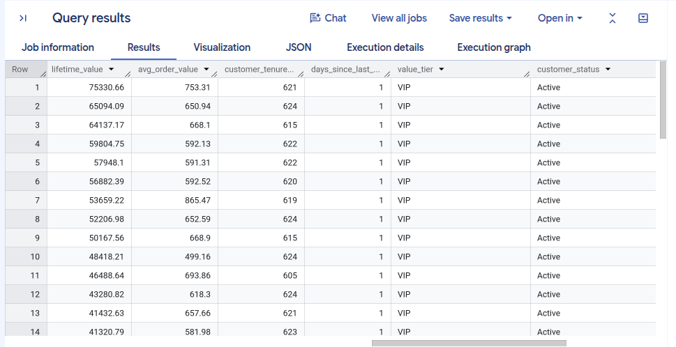

3. **Product Performance**: One row per product. Joins `products` (catalogue with unit cost) with `orders_latest` to compute revenue, cost of goods sold, profit, margin percentage, and a performance tier.

    ```sql
    SELECT * FROM `ecommerce_dwh_dev.product_performance`
    ORDER BY total_revenue DESC
    LIMIT 20;
    ```

    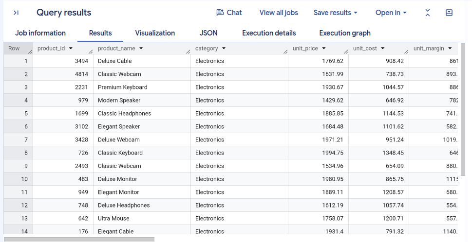
    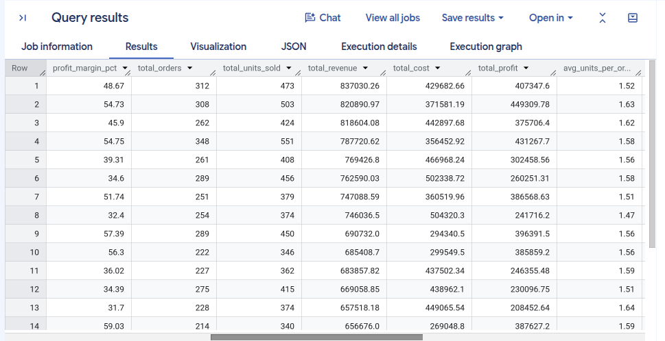
    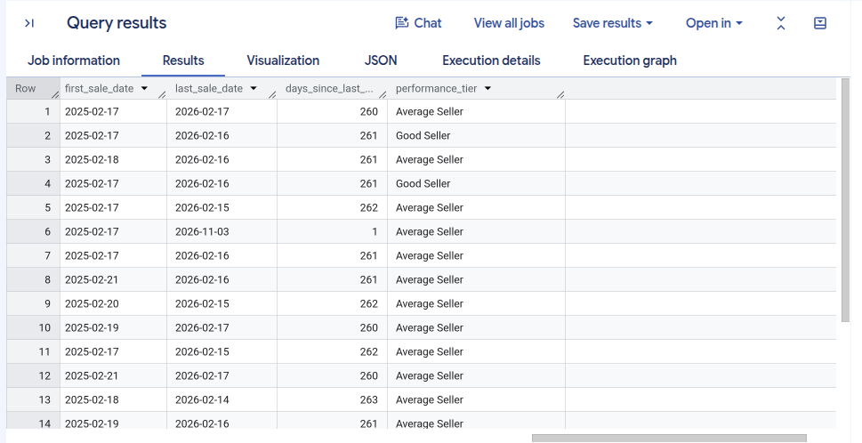

## Step 9: Monitoring and Alerting

This step adds alerting. The goal: someone gets a notification within minutes of a failure, with enough context to know what broke.

### What We’re Watching

Both Cloud Run Jobs already surface failure naturally:

| Job | Fails when |
|-|-|
| `etl-incremental-load` | incremental_load.py exits non-zero (uncaught exception, connection error, BQ load failure) |
| `etl-data-quality` | `quality_checks.py` exits 1 (any CRITICAL check fails) |

Cloud Run records every execution with a status: `SUCCEEDED` or `FAILED`. Cloud Monitoring can watch that status and fire an alert.

We need three things:
- A **notification channel** (where to send alerts — email, Slack, PagerDuty)
- An **alerting policy** for the incremental load job
- An **alerting policy** for the quality check job

### Create a Notification Channel

```bash
gcloud beta monitoring channels create \
    --display-name="ETL Pipeline Alerts" \
    --type=email \
    --channel-labels=email_address=you@example.com \
    --project=$PROJECT_ID
```

Output:

```bash
Created notification channel [CHANNEL_ID].
```

### Alert on Incremental Load Failure

Cloud Run Job execution failures are tracked under the metric `run.googleapis.com/job/completed_execution_count` with a `result` label that takes the value `failed` or `succeeded`.

Create an alerting policy that fires when a failed execution is detected:

```bash
cat > /tmp/alert_incremental_load.json << EOF
{
  "displayName": "ETL Incremental Load Failed",
  "documentation": {
    "content": "The nightly incremental load job failed. Check Cloud Run logs:\n\ngcloud logging read 'resource.type=\"cloud_run_job\" AND resource.labels.job_name=\"etl-incremental-load\"' --limit=50 --project=${PROJECT_ID}",
    "mimeType": "text/markdown"
  },
  "conditions": [
    {
      "displayName": "Cloud Run Job execution failed",
      "conditionThreshold": {
        "filter": "resource.type=\"cloud_run_job\" AND resource.labels.job_name=\"etl-incremental-load\" AND metric.type=\"run.googleapis.com/job/completed_execution_count\" AND metric.labels.result=\"failed\"",
        "comparison": "COMPARISON_GT",
        "thresholdValue": 0,
        "duration": "0s",
        "aggregations": [
          {
            "alignmentPeriod": "300s",
            "perSeriesAligner": "ALIGN_SUM"
          }
        ]
      }
    }
  ],
  "combiner": "OR",
  "enabled": true,
  "notificationChannels": ["${CHANNEL_ID}"],
  "alertStrategy": {
    "autoClose": "86400s"
  }
}
EOF

gcloud alpha monitoring policies create \
    --policy-from-file=/tmp/alert_incremental_load.json \
    --project=$PROJECT_ID
```

Output:

```bash
Created alert policy [ALERT_POLICY_ID].
```

### Alert on Data Quality Failure

Same pattern - different job name

```bash
cat > /tmp/alert_data_quality.json << EOF
{
  "displayName": "ETL Data Quality Check Failed",
  "documentation": {
    "content": "One or more CRITICAL data quality checks failed. Check which checks failed:\n\npython data-quality/quality_checks.py\n\nCommon causes: no fresh rows in the last 24h (pipeline missed a run), nulls in critical columns, duplicate order_ids in orders_latest view.",
    "mimeType": "text/markdown"
  },
  "conditions": [
    {
      "displayName": "Data quality job execution failed",
      "conditionThreshold": {
        "filter": "resource.type=\"cloud_run_job\" AND resource.labels.job_name=\"etl-data-quality\" AND metric.type=\"run.googleapis.com/job/completed_execution_count\" AND metric.labels.result=\"failed\"",
        "comparison": "COMPARISON_GT",
        "thresholdValue": 0,
        "duration": "0s",
        "aggregations": [
          {
            "alignmentPeriod": "300s",
            "perSeriesAligner": "ALIGN_SUM"
          }
        ]
      }
    }
  ],
  "combiner": "OR",
  "enabled": true,
  "notificationChannels": ["${CHANNEL_ID}"],
  "alertStrategy": {
    "autoClose": "86400s"
  }
}
EOF

gcloud alpha monitoring policies create \
    --policy-from-file=/tmp/alert_data_quality.json \
    --project=$PROJECT_ID
```

Output:

```bash
Created alert policy [ALERT_POLICY_ID].
```

### Test the Alert

Force a real failure: temporarily break the incremental load by passing an invalid bucket name, running the job, then fixing it back.

```bash
# Break it
gcloud run jobs update etl-incremental-load \
    --region=us-east1 \
    --update-env-vars="GCS_RAW_BUCKET=this-bucket-does-not-exist" \
    --project=$PROJECT_ID

# Trigger it
gcloud run jobs execute etl-incremental-load \
    --region=us-east1 \
    --project=$PROJECT_ID \
    --wait

# Fix it
gcloud run jobs update etl-incremental-load \
    --region=us-east1 \
    --update-env-vars="GCS_RAW_BUCKET=etl-pipeline-gcp-raw-dev" \
    --project=$PROJECT_ID
```

Output:

```bash
X Creating execution... Task etl-incremental-load-jt9qx-task0 failed with exit code: 1 and message: The container exited with an error.      
...        
Executing job failed                                                                                                                         
ERROR: (gcloud.run.jobs.execute) The execution failed.
...
```

Within a few minutes of the failed execution, you should receive an email.

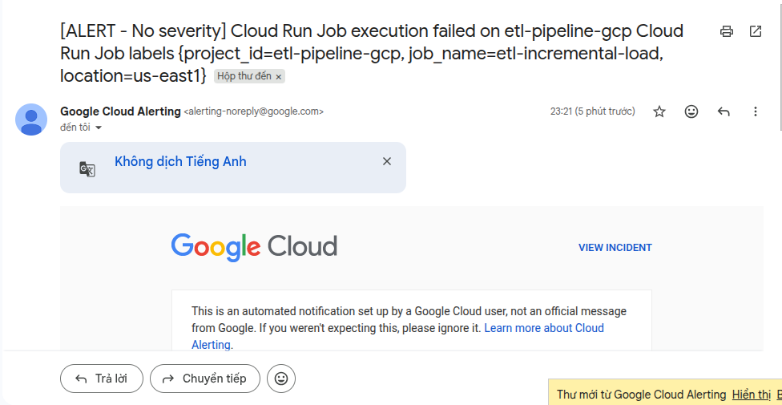

In the email content, click **View Incident**. You can trace the log and and identify the root cause of the error.

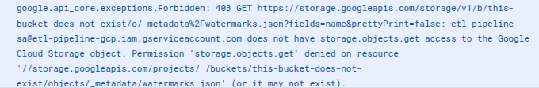